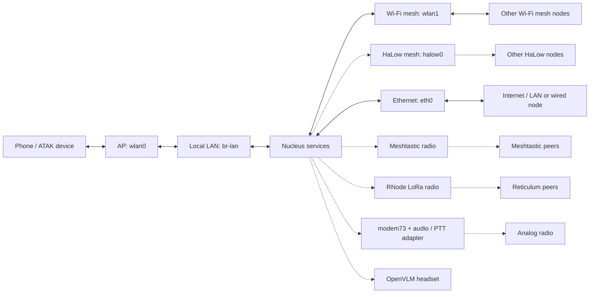
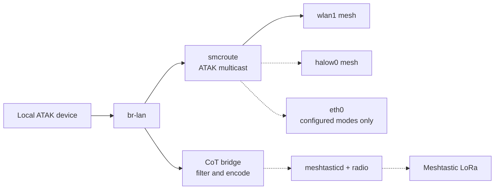
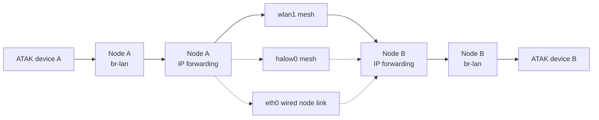
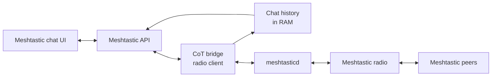
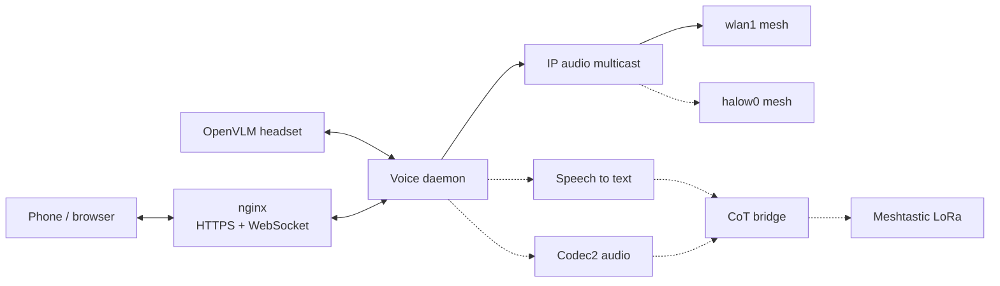
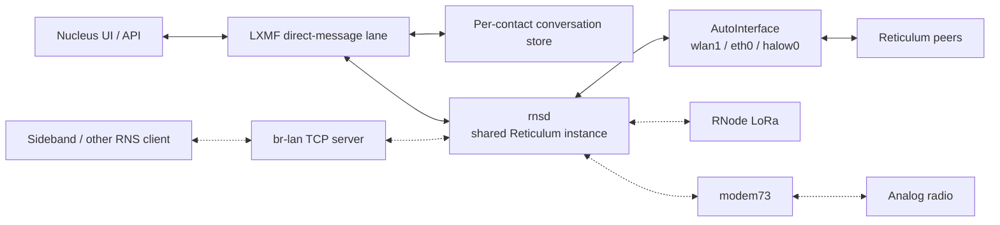
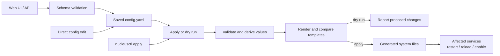

# Nucleus architecture and data flows

These are complementary views of one Nucleus node, not a map of a particular
deployment. They show possible paths, not live status or a promise of delivery.
An enabled service may still lack its radio, a matching peer, or a usable link.
See the linked manual pages for setup and troubleshooting.

**Reading the diagrams:** arrows show the direction of the depicted flow;
double arrows show two-way communication. Dashed lines indicate an optional or
conditional path. Interface names such as `wlan1` are node-side interfaces.
The diagrams omit addresses, ports and settings that are not needed to explain
the view.

## 1. Connections around a node

This is a connection map, not a forwarding diagram. A line to the Nucleus does
not mean every other line can carry the same traffic.

The dashed hardware links can communicate both ways when present and active;
dashes are used for their optional nature, not to imply transmit-only. The
Meshtastic and RNode LoRa radios are **separate** links with different
software and protocols. `eth0` can be a WAN or LAN connection; wired node
peering requires additional configuration. Babel handles IP unicast routing
over the enabled mesh interfaces and, when configured, Ethernet. Optional
Tailscale and TAK servers are not physical interfaces and are omitted here.

| Connection | Relevant settings or requirement |
|---|---|
| Wi-Fi mesh | `mesh.enabled`, matching mesh settings and an available `wlan1` radio. |
| HaLow | `halow.enabled`, supported radio present, and matching channel, bandwidth and primary index. |
| Ethernet node link | `eth0.babel` for Babel routing; `eth0.mcast_mode` separately controls ATAK multicast. |
| Meshtastic | `meshtastic.enabled`, a configured radio and compatible channel; transmit also depends on `meshtastic.tx_enabled`. |
| Reticulum radios | `reticulum.rnode_enabled` or `reticulum.modem73_enabled`, plus the appropriate radio and hardware. |

Details: [network stack](../README.md#3-network-stack),
[HaLow](manual/halow.md), [wired node link](manual/config.md#wired-node-link-eth0--turning-it-on),
[Reticulum](manual/reticulum.md), [Tailscale](manual/tailscale.md).

## 2. ATAK traffic

### Multicast

This example follows **outbound** ATAK multicast from a device on the local AP.
The bridge's LoRa path applies to supported CoT messages, not all ATAK
multicast traffic.

In the reverse direction, mesh multicast can be forwarded to `br-lan`;
received LoRa CoT is decoded by the bridge and injected into `br-lan`.
Ethernet relay has additional paths and loop-prevention constraints.

| Path | Conditions and boundaries |
|---|---|
| `br-lan` ↔ `wlan1` / `halow0` | ATAK multicast groups are routed without echoing back to the ingress interface. HaLow requires its enabled, present radio. |
| `wlan1` ↔ `halow0` | **No direct ATAK multicast forwarding** between these meshes. This is separate from the voice daemon's application-level fan-out shown below. |
| `br-lan` ↔ `eth0` | `eth0.mcast_mode: br_lan` or `mesh_relay`; `off` installs no eth0 multicast routes. |
| `eth0` ↔ radio meshes | `mesh_relay` only; at most one relay per Ethernet segment and other wired nodes must be RF-silent on the same meshes. |
| CoT → LoRa | `meshtastic.enabled`, `meshtastic.cot_bridge`, `meshtastic.tx_enabled`, working radio and accepted source; rate limits also apply. For relayed wired sources, configure `eth0.mcast_source_node_ids`. |

The node raises the TTL of incoming local ATAK multicast so it can be forwarded.
See [Ethernet mesh relay](manual/eth0-mesh-relay.md) for the complete
two-node topology, source filtering and constraints.

### Unicast

ATAK can also send traffic to a specific IP endpoint. This example shows a
device reaching a device on another node's LAN; the reverse direction needs
its own usable route and permitted traffic. The middle links are alternative
paths, not a requirement to use all three.

| Path | Conditions and boundaries |
|---|---|
| Between node LANs | Devices need reachable destination addresses and routes through their nodes; Babel distributes node LAN routes across working links. Firewall rules and the destination application must permit the traffic. |
| Via `eth0` | The wired node link needs `eth0.babel` on participating nodes and appropriate firewall rules. Unicast routing is independent of `eth0.mcast_mode`. |
| Same LAN | Devices can communicate directly on the LAN without traversing the mesh. |
| TAK server | A configured ATAK client can also use IP unicast to a reachable TAK Server or OpenTAKServer. A server is optional and may be local or remote; access and credentials depend on its setup. |

This is normal IP forwarding, not ATAK multicast routing through `smcroute`;
the CoT-to-LoRa bridge shown above is not a general unicast IP router. The
node can also send its own [ATAK notifications](atak-node-notifications.md)
as unicast to a known local device.

## 3. Meshtastic chat

The Meshtastic client provides channel chats and direct messages through the
local radio. The CoT bridge owns the radio connection and also maintains the
chat history.

| Path | Conditions and boundaries |
|---|---|
| Chat | `meshtastic.enabled`, `meshtastic.cot_bridge`, a running bridge, a usable radio and compatible peer channel settings. |
| Sending | `meshtastic.tx_enabled` must be on; receive-only mode still allows reception. |
| History | Chat history is kept in `/run` and cleared on reboot; preferences such as favorites and read marks persist. |

This is Meshtastic chat over LoRa, not ATAK GeoChat or Reticulum direct
messaging. See the [Meshtastic client](manual/meshtastic.md#meshtastic-client).

## 4. Push-to-talk voice

The operator selects one **transmit** transport; the voice daemon can listen
on its available receive paths independently. This is Nucleus PTT, not ATAK's
own multicast voice groups.

The arrows show outgoing audio; received audio travels back to the daemon and
its local playback devices. For voice-text, the remote node converts received
text to speech; it is not a live audio stream.

| Path | Conditions and boundaries |
|---|---|
| IP voice | `voice.enabled`; matching voice channel and usable mesh interface. Sends on `wlan1` and enabled, available `halow0`, with duplicate frames suppressed on receive. |
| Browser PTT | HTTPS and a working WebSocket through nginx; no OpenVLM headset is required. |
| LoRa voice-text | `voice.lora_enabled`, installed speech models and a working Meshtastic bridge/radio. A completed utterance is sent as text, then spoken at the receiver. |
| LoRa Codec2 | `voice.stream_enabled`, usable codec and Meshtastic bridge/radio. This is a separate selected transport from voice-text. |

LoRa transmit also depends on `meshtastic.tx_enabled`. See
[voice internals](manual/voice-internals.md) and [voice controls](manual/voice.md).

## 5. Reticulum and direct messages

Reticulum is a separate network stack; its RNode radio is not the Meshtastic
radio. The Nucleus LXMF messaging lane attaches to the existing shared `rnsd`
instance rather than starting a second stack.

| Path | Conditions and boundaries |
|---|---|
| Nucleus direct messages | `messaging.enabled`, `messaging.rns.enabled` and running `rnsd`; a usable contact identity and path are needed. Conversations persist separately from Meshtastic chat. |
| AutoInterface | `reticulum.enabled` and `reticulum.auto_interface`; peer reachability depends on the configured interfaces and their links. HaLow requires its radio. |
| Client on AP/LAN | `reticulum.tcp_server`; the client connects to the node's `br-lan` address and configured TCP port. |
| RNode / modem73 | Corresponding `reticulum.rnode_enabled` / `reticulum.modem73_enabled` setting and working hardware. Automatic announces are not flooded onto these slow radios; an operator can announce over a selected radio. |

The rendered Reticulum template currently disables the public entry-node
interface even though entry-node settings exist. See
[Reticulum](manual/reticulum.md).

## 6. Configuration and apply

The API validates and saves configuration separately from applying it. A dry
run reports intended changes without writing generated files or restarting
services. Apply updates files only when their contents change and reconciles
the affected services.

Not every operation goes through this pipeline: Tailscale has its own live
state, the AP radio toggle is non-persistent, and official TAK Server or
OpenTAKServer is separately installed. See the
[config pipeline](../README.md#1-core-logic--the-config-pipeline) and
[exceptions](../README.md#4-outside-the-pipeline-intentional).

When documenting a particular node, record the configuration and observed
interface/service status separately; neither alone proves that a peer is
reachable. Avoid including passwords, auth keys or other secrets in diagrams.
